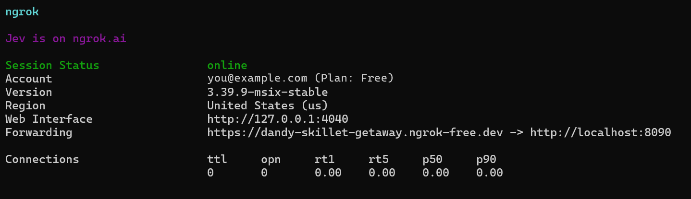
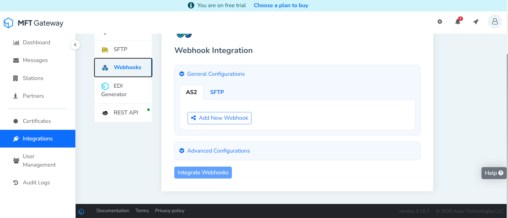
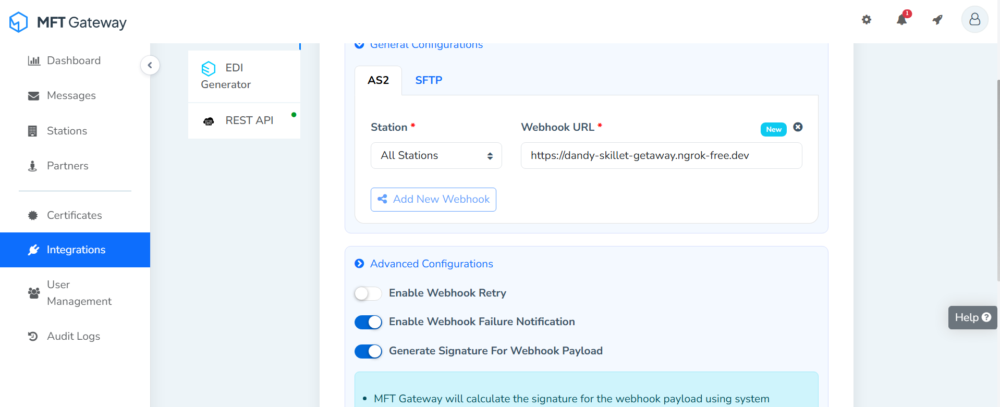
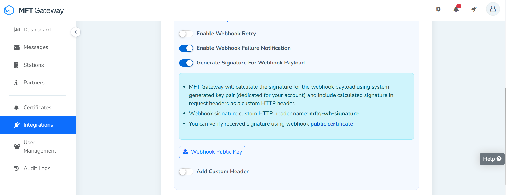
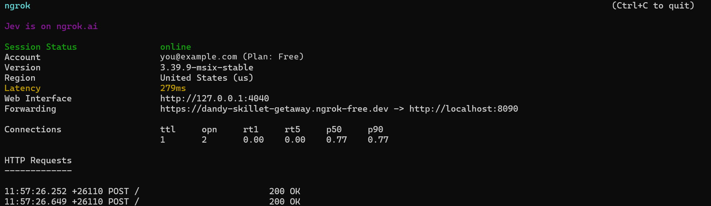

## Overview

The Aayu MFT Gateway AS2 Trigger module allows you to listen to the AS2 webhook events of
[Aayu MFT Gateway](https://aayutechnologies.com/docs/product/mft-gateway/):
- `MESSAGE.RECEIVED.SUCCESS`: an AS2 message was received from a trading partner
- `MESSAGE.SEND.SUCCESS`: an AS2 message was sent to a trading partner
- `MESSAGE.SEND.FAILED`: sending an AS2 message failed
- `MESSAGE.SEND.INCOMPLETE`: an AS2 message was sent but its delivery was not confirmed

This module receives MFT Gateway's webhook deliveries directly - it does not call the MFT Gateway
API on your behalf. It covers the AS2 events only; SFTP webhooks use different payloads.

### Key features

- Receives the four MFT Gateway AS2 events: message received, sent, send failed and send incomplete
- Verifies every delivery with the webhook public key from MFT Gateway (RSA with SHA-256, `mftg-wh-signature`)
- Typed payload records matching MFT Gateway's documented AS2 payloads
- Acknowledges each delivery before running your handler, so a slow or failing handler doesn't cause retries
- Services can be attached on their own path, so several triggers and HTTP services can share one port
- Trigger services are listed by `bal build --export-endpoints` (Ballerina 2201.13.6 or later)

## Setup guide

Before using this trigger in your Ballerina application, you need an MFT Gateway account with at
least one AS2 station and trading partner, and a Ballerina service that MFT Gateway can reach over
the internet to deliver webhook events to. The two sections below cover both a quick local test
setup and a production deployment.

### Try it out locally

Use this flow to test your event handling logic on your own machine before deploying anywhere,
using [ngrok](https://ngrok.com/) to expose your local listener to the internet.

1. Expose port `8090` with ngrok:

   ```bash
   ngrok http 8090
   ```

   Copy the `Forwarding` URL ngrok prints out - this is your temporary public webhook URL.

   

2. In MFT Gateway, open **Integrations > Webhooks** from the left navigation menu and select the
   **AS2** tab under **General Configurations**.

   

3. Click **Add New Webhook** and fill it in:
   - **Station**: the station you want events for, or **All Stations**.
   - **Webhook URL**: the ngrok forwarding URL from step 1.
   - Under **Advanced Configurations**, turn on **Generate Signature For Webhook Payload**. The
     listener rejects unsigned requests, so this is required.

   

4. Click **Integrate Webhooks** to save. A **Webhook Public Key** button then appears under the
   signature note; click it to download `webhook-pubkey.pem`. MFT Gateway signs each payload with a key pair dedicated to
   your account and sends the signature in the `mftg-wh-signature` header; the listener checks it
   with this public key.

   

5. Put the whole public key, including the `-----BEGIN PUBLIC KEY-----` and
   `-----END PUBLIC KEY-----` lines, in a `Config.toml` next to your service (see
   [Quickstart](#quickstart) below), and run it with `bal run`:

   ```toml
   [<your_org>.<your_module_name>.userInput]
   webhookSecret = """-----BEGIN PUBLIC KEY-----
   MIICIjANBgkqhkiG9w0BAQEFAAOCAg8AMIICCgKCAgEA...
   -----END PUBLIC KEY-----"""
   ```

6. Send an AS2 message from **Messages > Compose** to one of your partners, or have a partner send
   one to your station. Each delivery shows up in the ngrok console with `200 OK`, and your handler
   runs. To try it without a real trading partner, add a partner whose AS2 identifier, URL and
   certificate are your own station's (shown under **View Partner Configuration** on the station),
   and send to it: you get both a sent and a received event.

   

### Production / business integration

For production use, deploy your Ballerina service somewhere with a stable, internet-reachable
HTTPS URL. Ballerina doesn't require any specific hosting platform - containers, a VM, a managed
PaaS, or anything else that gives you a stable HTTPS endpoint all work equally well.

Keep the public key in `Config.toml` (or your platform's equivalent configuration/secret
mechanism) as shown above, then set your production URL as the webhook URL in MFT Gateway.

If you turn on **Enable Webhook Retry**, MFT Gateway sends a failed delivery again and marks it with
the `mftg-wh-retry` header. The listener responds before it runs your handler, so slow handlers
don't cause retries, but a retry can still arrive after a network problem. Use `messageId` together
with `eventType` to skip events you have already handled.

### Compatibility

|                     | Version                       |
|---------------------|-------------------------------|
| Ballerina Language  | Ballerina Swan Lake 2201.13.0 |

## Quickstart

To use the Aayu MFT Gateway AS2 Trigger in your Ballerina application, update the `.bal` file as
follows:

### Step 1: Import the Aayu MFT Gateway AS2 Trigger Ballerina library

```ballerina
import ballerinax/aayu.mftg.as2.trigger as aayu;
```

### Step 2: Initialize the Aayu MFT Gateway Listener

Initialize the trigger by providing the listener config and a port number/`http:Listener` object.

```ballerina
configurable aayu:ListenerConfig userInput = ?;
listener aayu:Listener aayuListener = new (userInput, 8090);
```

`webhookSecret` in `userInput` is the public key downloaded from MFT Gateway, set in `Config.toml`
as shown in the [Setup guide](#setup-guide) - this is what the trigger uses to verify incoming
events actually came from MFT Gateway.

If you don't provide a port it will use the default port, which is 8090.

```ballerina
listener aayu:Listener aayuListener = new (userInput);
```

### Step 3: Use the correct service type to implement the service

Each event has its own service type with a single remote function:

| Event | Service type | Remote function |
|-------|--------------|-----------------|
| `MESSAGE.RECEIVED.SUCCESS` | `ReceivedMessageService` | `onMessageReceivedSuccess` |
| `MESSAGE.SEND.SUCCESS` | `SentMessageService` | `onMessageSendSuccess` |
| `MESSAGE.SEND.FAILED` | `FailedMessageService` | `onMessageSendFailed` |
| `MESSAGE.SEND.INCOMPLETE` | `IncompleteMessageService` | `onMessageSendIncomplete` |

### Step 4: Provide remote functions corresponding to the events you're interested in

Attach one service per event you want, all on the same listener - for example,
`aayu:ReceivedMessageService` for received messages.

```ballerina
import ballerina/log;

service aayu:ReceivedMessageService on aayuListener {

    remote function onMessageReceivedSuccess(aayu:MessageReceivedEvent payload) returns error? {
        log:printInfo("AS2 message received", partner = payload.partnerName,
                subject = payload.messageSubject, attachments = payload.attachments);
    }
}
```

### Step 5: Run the service

Use the `bal run` command to compile and run the Ballerina program.

### Step 6: Register a webhook so MFT Gateway can reach your service

See [Setup guide](#setup-guide) above for the full walkthrough (with screenshots) of exposing your
service and registering the webhook, for both local testing and production use.

## Examples

The `aayu.mftg.as2.trigger` module provides practical examples illustrating usage in various
scenarios. Explore these [examples](https://github.com/ballerina-platform/module-ballerinax-aayu.mftg.as2.trigger/tree/main/examples/),
covering common AS2 event handling use cases.

## Report issues

To report bugs, request new features, start new discussions, etc., go to the
[Ballerina Library repository](https://github.com/ballerina-platform/ballerina-library).

## Useful links

- For more information go to the [`aayu.mftg.as2.trigger` package](https://central.ballerina.io/ballerinax/aayu.mftg.as2.trigger/latest).
- If you're moving from the older `trigger.aayu.mftg.as2` package, see the [migration notes](https://github.com/ballerina-platform/module-ballerinax-aayu.mftg.as2.trigger/blob/main/docs/migration-notes.md).
- For example demonstrations of the usage, go to [Ballerina By Examples](https://ballerina.io/learn/by-example/).
- Chat live with us via our [Discord server](https://discord.gg/ballerinalang).
- Post all technical questions on Stack Overflow with the [#ballerina](https://stackoverflow.com/questions/tagged/ballerina) tag.
